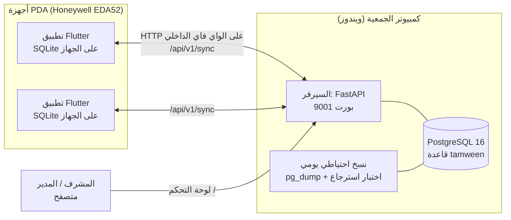
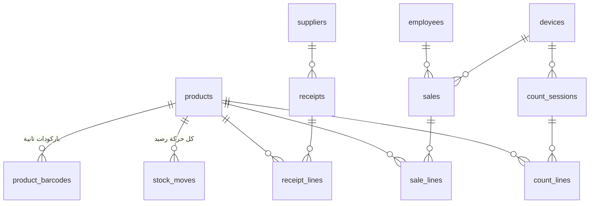
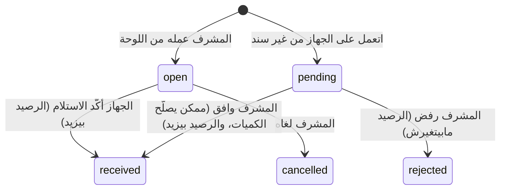
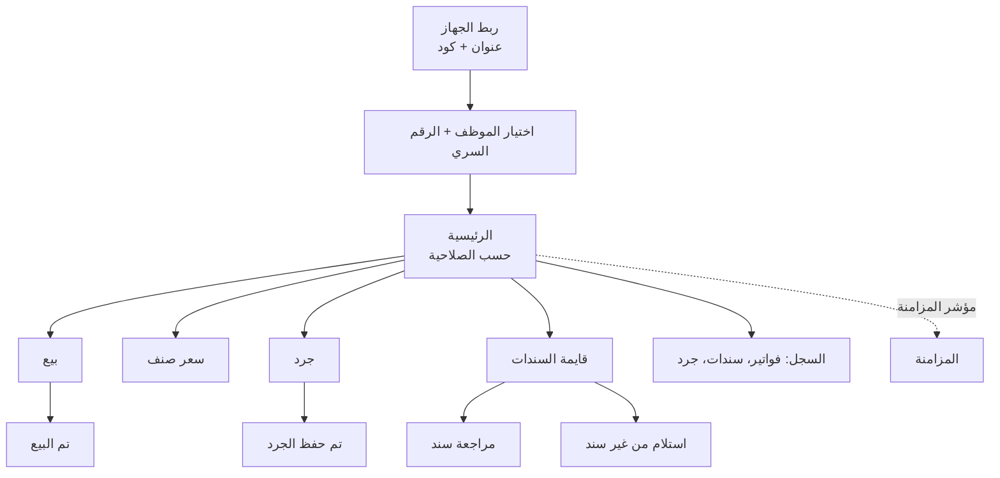
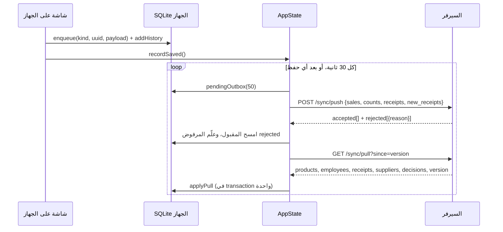
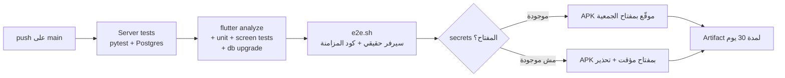

# معمارية نظام تموين

الملف ده بيشرح النظام كله: أجزاؤه، وإزاي بتتكلم مع بعض، والبيانات متخزنة فين، والقرارات اللي اتاخدت وأسبابها. لو هتعدّل حاجة في الكود، اقرا القسم بتاعها الأول.

## ١. الصورة الكبيرة



| الجزء | المسار | التقنية | دوره |
|---|---|---|---|
| السيرفر ولوحة التحكم | `server/` | Python 3.12، FastAPI، SQLAlchemy 2، Jinja2 | مصدر الحقيقة لكل البيانات، والـ API للأجهزة، والصفحات العربية للإدارة |
| قاعدة البيانات | على كمبيوتر الجمعية | PostgreSQL 16 | كل الأصناف والمبيعات والأرصدة والسجلات |
| تطبيق الجهاز | `app/` | Flutter (أندرويد)، sqflite | البيع والجرد والاستلام بالقارئ، **ويشتغل من غير شبكة** |
| البناء والاختبار | `.github/workflows/ci.yml` | GitHub Actions | اختبارات السيرفر والتطبيق، والـ APK الموقّع |
| سكربتات | `scripts/`، `server/*.bat`، `server/setup.ps1` | Bash، PowerShell | التثبيت على ويندوز، ومفتاح التوقيع، والاختبار الكامل |

**المبدأ الأساسي:** الجهاز **أوفلاين أولاً**. أي عملية (بيع، جرد، استلام) بتتحفظ على الجهاز الأول، وبعدين بتتبعت للسيرفر لما يكون فيه اتصال. السيرفر هو مصدر الحقيقة للأرصدة والأسعار، والجهاز معاه نسخة منها ممكن تكون متأخرة.

## ٢. السيرفر (`server/`)

```
server/
  run.py               بيشغّل uvicorn على 0.0.0.0:9001، وبيعمل الجداول، وبيكتب SECRET_KEY في .env أول مرة
  app/
    main.py            إنشاء التطبيق، والـ session middleware، والملفات الثابتة، وتسجيل الـ routers
    config.py          الإعدادات من .env: DATABASE_URL وPORT وTZ_NAME وBACKUP_DIR
    db.py              الـ engine، وsync_version، وinit_db، والترقيات (UPGRADES)
    models.py          كل الجداول (القسم ٣)
    security.py        PBKDF2 للرقم السري وكلمة السر، وتوكن الأجهزة، وكود الربط
    services.py        قواعد الشغل: pull وpush والمخزون والموافقات
    api.py             API الأجهزة /api/v1
    dashboard.py       صفحات لوحة التحكم
    templates/*.html   Jinja2 عربي RTL
    static/style.css
  scripts/backup.py    نسخ احتياطي + فحص + اختبار استرجاع + backup.log
  scripts/demo_data.py بيانات تجريبية لقاعدة فاضية
  setup.ps1/.bat       تثبيت كامل على ويندوز (القسم ٩)
  start.bat            تشغيل يدوي، أو فتح اللوحة لو السيرفر شغال
  tests/               pytest على PostgreSQL حقيقي
```

**طبقات الكود:** `api.py` و`dashboard.py` بيستقبلوا الطلب ويتأكدوا من الصلاحية. أي قاعدة من قواعد الشغل (تحريك المخزون، الاعتماد، المزامنة) موجودة في `services.py` بس، علشان الجهاز ولوحة التحكم يطبّقوا نفس القواعد.

### API الأجهزة (`/api/v1`)

| الطلب | محتاج توكن؟ | الوظيفة |
|---|---|---|
| `GET /ping` | لا | الجهاز بيتأكد إن العنوان ده سيرفر تموين |
| `POST /pair` | لا (كود الربط) | بيبدّل كود من 6 أرقام بتوكن الجهاز. الكود بيشتغل مرة واحدة، وصالح 30 دقيقة |
| `GET /sync/pull?since=N` | نعم | بينزّل اللي اتغير بعد رقم الإصدار N (القسم ٥) |
| `POST /sync/push` | نعم | بيرفع العمليات اللي على الجهاز (القسم ٥) |

التوكن بيتبعت في `Authorization: Bearer …`، والسيرفر بيخزن الـ SHA-256 بتاعه بس. لو الجهاز اتوقف أو اتعمله ربط جديد، السيرفر بيرد بـ 401، والجهاز بيعرض «غير مربوط».

### لوحة التحكم

صفحات بتتولد على السيرفر (مفيش framework للواجهة)، والدخول بجلسة cookie موقّعة.

الصلاحيات **بتتحدد من اللوحة** (الإدارة ← الأدوار والصلاحيات). كل موظف ليه دور واحد، والدور عبارة عن اسم + مجموعة صلاحيات (جدول `roles`). أي صفحة في اللوحة بتطلب صلاحيتها (`need[...]` في `dashboard.py`)، والقائمة الجانبية بتعرض بس اللي الموظف يقدر يفتحه.

| الصلاحية | المكان | بتسمح بإيه |
|---|---|---|
| `sale` | الجهاز | البيع |
| `price` | الجهاز | شاشة سعر صنف |
| `see_cost` | الجهاز | يشوف سعر الشراء في السعر وتفاصيل البيع |
| `count` | الجهاز | الجرد |
| `receive` | الجهاز | استلام السندات المفتوحة |
| `new_receipt` | الجهاز | استلام من غير سند (بيستنى موافقة) |
| `device_admin` | الجهاز | فك ربط الجهاز، ورؤية العمليات اللي السيرفر رفضها |
| `dashboard` | اللوحة | الدخول (ومعاها اسم مستخدم وكلمة سر) |
| `products`، `receipts`، `sales`، `counts` | اللوحة | **مشاهدة** الأصناف والموردين وسجل الأسعار، السندات، المبيعات والتقارير، الجرد |
| `employees`، `devices`، `backup` | اللوحة | الموظفين والأدوار، الأجهزة، النسخ الاحتياطي |
| `accounting` | اللوحة | مشاهدة سجل الفواتير والسندات والجرد في صفحة «السجل» |
| `audit` | اللوحة | السجل الكامل: كل التغييرات والدخول على اللوحة. للمدير بس افتراضياً |

أول تشغيل بيعمل 5 أدوار: كاشير، أمين مخزن، مشرف، محاسب، مدير. **صلاحيات اللوحة لأي دور غير المدير معناها مشاهدة وطباعة بس**: التعديل للمدير. التلاتة الأولانيين بيتعدّلوا أو يتمسحوا (لو مفيش موظف عليهم). **«مدير» ثابت وليه كل الصلاحيات دايماً**، والموظف مايقدرش يشيل من دوره أو حسابه صلاحية الموظفين أو الدخول. ده علشان النظام ميتقفلش على الكل.

لما دور يتعدّل، السيرفر بيرفع `version` لكل موظفينه، فالأجهزة بتاخد الصلاحيات الجديدة في أول مزامنة. الجهاز بيطبّق الصلاحيات وهو أوفلاين من نسخته. السيرفر **مش بيرفض** بيع أو جرد اتعمل قبل ما الصلاحية تتشال، لأن العملية حصلت فعلاً، ورفضها كان هيبوّظ الرصيد.

## ٣. البيانات على السيرفر



| الجدول | أهم الأعمدة | ملاحظات |
|---|---|---|
| `products` | `barcode` (الأساسي)، `unit` (piece/kg)، `price`، `cost`، `carton`، `stock`، `min_stock`، `version` | `stock` بالوحدة الأساسية (حبة أو كجم) |
| `product_barcodes` | `code` (فريد في النظام كله)، `mode` (piece/carton/kg) | باركود الكرتون، أو باركود تاني لنفس الحبة |
| `stock_moves` | `delta`، `reason` (sale/receipt/count/manual)، `ref` | **أي تغيير في الرصيد بيعدّي من هنا** |
| `receipts` | `status`، `client_id`، `approved_by`، `device_notes` | الحالات تحت |
| `receipt_lines` | `ordered`، `received`، `received_mode`، `extra`، `note` | `note` ملاحظة الموظف على الصنف |
| `sales` / `sale_lines` | `id` = UUID من الجهاز، `unit_price`، `unit_cost` | السعر والتكلفة بيتحفظوا وقت البيع |
| `count_sessions` / `count_lines` | `counted`، `stock_at_sync`، `status` | `stock_at_sync` الرصيد وقت ما الجرد وصل |
| `roles` | `key`، `name`، `permissions` (مفصولة بفاصلة) | `admin` ثابت وليه كل الصلاحيات |
| `audit_log` | `at`، `actor`، `reason`، `table_name`، `row_id`، `action`، `changes` (JSONB: العمود ← [قبل، بعد]) | بيتكتب من الـ triggers بس، ومايتعدلش ولا يتمسح |
| `employees` | `role` (مفتاح الدور)، `pin_salt` و`pin_hash`، `username` و`password_hash` | الرقم السري للجهاز، وكلمة السر للوحة |
| `devices` | `token_hash`، `pairing_code`، `last_seen` | |
| `suppliers` | `name` (فريد) | |

**الفلوس والكميات** متخزنة `Numeric(12,3)` و`Numeric(14,3)`، يعني 3 أرقام عشرية للدينار والكيلو، ومفيش أي حسابات بالـ float.

### حالات السند



## ٤. تطبيق الجهاز (`app/`)

```
app/lib/
  main.dart                البداية: Root بيختار ربط ← دخول ← الرئيسية
  data/
    db.dart                LocalDb: SQLite على الجهاز وكل الاستعلامات
    app_state.dart         AppState: الربط والموظف الحالي ودورة المزامنة كل 30 ثانية
    api.dart               عميل HTTP وأكواد الأخطاء (offline/unpaired/…)
    models.dart            Product وEmployee وReceiptDoc وSaleLine وScanHit وHistoryEntry
  ui/
    design.dart            نظام التصميم: الألوان، والخطوط T، والمسافات S، والمصطلحات W
    widgets.dart           ScanListener، وWorkScaffold، وItemRow، والـ number pad، والـ sheets
    scan_helpers.dart      البحث بالباركود ورسالة «الصنف غير مسجل»
    *_screen.dart          الشاشات
  util/
    format.dart            money / qty / lineTotal بالأعداد الصحيحة (فلس، وجزء من الألف)
    pin_hash.dart          PBKDF2 مطابق للسيرفر
    feedback.dart          صوت واهتزاز (MethodChannel → ToneGenerator)
    ids.dart               UUID v4
```

**الحالة:** مفيش مكتبة state management. `AppState` بيورّث `ChangeNotifier`، وبيوصل للشاشات عن طريق `AppScope` (`InheritedNotifier`). الشاشات بتقرا من `LocalDb` على طول.

**الأرقام على الجهاز:** الفلوس **بالفلس** (`int`)، والكميات **بالجزء من الألف** (`int`)، فـ 1.250 كجم = 1250. ده بيمنع أخطاء التقريب في الإجماليات.

### قاعدة بيانات الجهاز (SQLite، الإصدار 7)

| الجدول | المحتوى |
|---|---|
| `products` + `barcodes` | الأصناف والأسعار (والتكلفة) والأرصدة والباركودات التانية، نسخة من السيرفر |
| `employees` | الموظفين والـ hash بتاع الرقم السري، واسم الدور وصلاحياته، علشان الدخول والصلاحيات يشتغلوا من غير شبكة |
| `receipts` | السندات المفتوحة اللي جاية من السيرفر |
| `suppliers` | الموردين، للسند الجديد |
| `outbox` | **العمليات اللي مستنية تتبعت.** `id` = `kind:uuid`، و`state` = pending أو rejected |
| `history` | سجل 60 يوم لكل اللي اتعمل على الجهاز، ومعاه قرار المشرف |
| `kv` | الإعدادات والمسودات (`draft_sale` و`draft_count` و`draft_receipt_N` و`draft_new_receipt`)، و`version` و`last_sync` |

**الترقية:** `onUpgrade` بيضيف جداول وأعمدة من غير ما يمسح حاجة، وكل ترقية بتفرض تنزيل كامل للبيانات (`version = 0`). في `test/db_upgrade_test.dart` اختبار بيتأكد إن جهاز من الإصدار 1 بيترقى، والعمليات اللي لسه ماتبعتتش بتفضل موجودة.

### الشاشات



### القارئ (Keyboard Wedge)

`ScanListener` موجود حوالين كل شاشة شغل، وبيستقبل الباركود بالطريقتين اللي أجهزة Honeywell بتبعت بيهم:

1. **ضغطات مفاتيح:** عن طريق `HardwareKeyboard`، من غير ما يحتاج خانة كتابة.
2. **نص بيتكتب في الخانة:** خانة مخفية التركيز دايماً عليها، ونوعها `TextInputType.none` علشان كيبورد الشاشة مايظهرش.

الكود بيخلص بـ Enter أو Tab. لو مفيش ولا واحد فيهم، وجت حروف بسرعة القارئ (أقل من 60 مللي ثانية بين كل حرف) ووقفت، بيعتبرها مسح. الكتابة البطيئة بالإيد مش بتتحسب مسح. `ScanBox` بيعرض الحالة: **جاهز** (أخضر)، أو **بيقرا** (أزرق)، أو **واقف** (برتقالي، لما تكون فاتح خانة كتابة تانية)، ومعاها آخر باركود اتقرا.

**الوحدة من الباركود:** `LocalDb.lookup` بيرجّع `ScanHit(product, mode)`. باركود الكرتون بيدّي `carton`، والباركود الأساسي بيدّي `piece` أو `kg`. في الاستلام والجرد، **باركود الكرتون بس** هو اللي بيغيّر الوحدة.

## ٥. المزامنة



**التنزيل (pull):**
- كل صف قابل للتزامن (`products` و`employees` و`receipts`) عليه `version` بياخد قيمته من sequence واحدة في PostgreSQL اسمها `sync_version`، وأي تعديل بيدّيله رقم جديد أكبر.
- الجهاز بيطلب اللي أكبر من آخر رقم عنده (`since`).
- `since=0` معناه نسخة كاملة، والجهاز بيعمل نسخة كاملة كل ساعة وأول ما التطبيق يفتح، علشان يصلّح أي حاجة فاتته.
- الموردين بيتبعتوا كلهم كل مرة لأنهم قليلين.
- `decisions` فيها قرار المشرف على السندات اللي **الجهاز ده** عملها في آخر 60 يوم.

**الرفع (push):**
- كل عملية ليها `id` من الجهاز: UUID للبيع والجرد والسند الجديد، ورقم السند للاستلام. **لو نفس العملية اتبعتت تاني**، مثلاً لأن الرد ضاع، السيرفر بيقبلها من غير ما يسجّلها تاني.
- كل عملية بتتحفظ في savepoint لوحدها، فعملية فيها غلط مابتوقفش الباقي.
- لو السيرفر رفض عملية، بيبعت السبب (`unknown_product` و`bad_line` و`receipt_not_open` و…)، والجهاز بيعرضه بالعربي في شاشة المزامنة.

**تحريك المخزون:**
- كل حركة بتعدّي على `services.move_stock`، وده بيعمل `UPDATE products SET stock = stock + delta` على مستوى قاعدة البيانات. ده بيمنع إن بيع من جهازين في نفس اللحظة يضيّع خصم، وفيه اختبار لده في `test_concurrent_sales_do_not_lose_stock`.
- كل حركة بتكتب صف في `stock_moves`.

| العملية | إمتى الرصيد بيتغير على السيرفر |
|---|---|
| بيع | أول ما يوصل للسيرفر |
| استلام سند مفتوح | أول ما يوصل للسيرفر |
| سند اتعمل على الجهاز | **لما المدير يوافق** |
| جرد | **لما المدير يعتمد** (جرد اليوم كله مع بعض لو فيه أكتر من لجنة). الفرق = المعدود − `stock_at_sync`، علشان البيع اللي حصل بعد وصول الجرد مايضيعش |
| تصحيح فاتورة أو سند مستلم أو جرد | من المدير، بسبب إجباري، والرصيد بيتظبط بالفرق |

**مفيش تعديل رصيد يدوي.** الرصيد مابيتكتبش من صفحة الصنف، ولا وقت إضافة صنف جديد (بيبدأ بـ 0)، ولا من الاستيراد (عمود `stock` بيتجاهل). الرصيد الافتتاحي بييجي من جرد أو سند استلام. كده كل رقم في الرصيد وراه عملية ليها رقم وسجل. الحركات القديمة من نوع `manual` بتفضل في السجل.

الجهاز كمان بيعدّل الرصيد اللي عنده على طول بعد البيع والاستلام، علشان شاشة السعر تبقى قريبة من الحقيقة. وفي أول مزامنة، الرقم بيتستبدل برقم السيرفر.

## ٦. خطوات الشغل الأساسية

**البيع:**
- كل مسح بيزوّد حبة.
- باركود الكرتون بيزوّد كرتون.
- الصنف الموزون بيفتح لوحة الوزن.
- لو مسحت نفس الصنف بنفس الوحدة، بيتزوّد على البند، ومعاه زرار «بند منفصل».
- لو مسحته بوحدة مختلفة، بيسألك: تزوّد على القديم (بالحبة) ولا بند جديد.
- «تم الدفع» بيحط البيع في الـ outbox ويسجّله في السجل.

**الجرد:**
- جرد أعمى: الموظف مش بيشوف رصيد النظام.
- لو مسحت صنف اتعد قبل كده، بيسألك: تزوّد على نفس البند ولا بند جديد (رف تاني).
- البنود بتتجمع لكل صنف وقت الإرسال.
- المشرف بيعتمد الجرد أو يرفضه من اللوحة.

**الاستلام بسند:**
- لكل صنف: «كامل» أو كمية مختلفة، وملاحظة اختيارية.
- السند مابيتأكدش غير لما كل الأصناف تتراجع.
- قبل التأكيد بيظهر ملخص الفروق.

**الاستلام من غير سند:**
- تختار المورد، أو تكتب اسم مورد جديد.
- تمسح الأصناف وتكتب الكميات.
- السند بيتبعت `new_receipts`، وبيتسجل على السيرفر `pending`.
- المشرف يوافق (ويصلّح الكميات لو محتاج) أو يرفض.
- القرار بيرجع للجهاز في `decisions`، وبيظهر في السجل وفي تنبيه على الرئيسية.

## ٧. الأمان

| الموضوع | التنفيذ | الحدود |
|---|---|---|
| ربط الأجهزة | كود من 6 أرقام لمرة واحدة، صالح 30 دقيقة، وبعدها توكن عشوائي، والسيرفر بيخزن الـ hash بتاعه بس | أي حد معاه الجهاز وهو مربوط يقدر يبعت عمليات. لو جهاز ضاع، «إيقاف» من اللوحة |
| دخول الموظف على الجهاز | رقم سري من 4 لـ 6 أرقام، PBKDF2 بـ 20,000 تكرار، والتحقق على الجهاز | الـ hash متخزن على الجهاز، وأي حد يطلّع قاعدة البيانات يقدر يجرّب كل الأرقام |
| لوحة التحكم | اسم مستخدم + كلمة سر (PBKDF2 بـ 260,000 تكرار)، وجلسة cookie موقّعة SameSite=Lax | مفيش حد لعدد المحاولات |
| الشبكة | HTTP على الشبكة الداخلية بس. الجدار الناري مفتوح لـ Private وDomain ولنفس الشبكة المحلية بس | **مش مشفّر.** واي فاي الأجهزة لازم يبقى منفصل عن واي فاي الزباين |
| قاعدة البيانات | مستخدم `tamween_app` من غير صلاحيات إدارية، صاحب قاعدة `tamween` بس. ملفات `.env` و`.secrets` مقفولة على المديرين | كلمة سر `postgres` متخزنة في `.secrets` علشان اختبار الاسترجاع |
| سعر الشراء | بينزل على الأجهزة، وده بقرار صاحب المشروع | أي حد يطلّع قاعدة بيانات الجهاز هيعرفه |

## ٨. البناء والإصدار



- اختبارات الشاشات بتشتغل على **360×640**، ومنها اختبار بخط مكبّر 1.3 مرة واسم صنف طويل. أي نص بيطلع بره الشاشة بيوقع الاختبار.
- التوقيع بييجي من `ANDROID_KEYSTORE_BASE64` و`ANDROID_KEYSTORE_PASSWORD` و`ANDROID_KEY_ALIAS`، و`ANDROID_KEY_PASSWORD` اختياري. المفتاح بيتعمل مرة واحدة بـ `scripts/make-signing-key.*`. **لو المفتاح ضاع، مش هتقدر تحدّث التطبيق على الأجهزة.**
- `versionCode` هو رقم التشغيل في GitHub، علشان كل APK جديد يتثبت فوق اللي قبله.

## ٩. التشغيل على كمبيوتر الجمعية

`setup.bat` بيشغّل `setup.ps1` بصلاحية مدير. أي خطوة تفشل بتوقف الإعداد وتقول السبب، ولو اتعادت بتعدّي اللي اتعمل قبل كده:

1. يثبّت Python 3.12 وPostgreSQL 16 بـ winget لو مش موجودين. كلمة سر `postgres` بتتحفظ في `.secrets` **قبل** التثبيت.
2. يحدد نسخة PostgreSQL والخدمة والبورت بتوعها من سجل ويندوز.
3. يعمل المستخدم `tamween_app` وقاعدة `tamween`، وبعدين `.env`، ويقفل الملفات.
4. يعمل البيئة `.venv` ويثبّت المكتبات ويعمل الجداول.
5. **نسخة احتياطية + استرجاعها في قاعدة تجريبية + مقارنة الصفوف**، وبعدين مهمة يومية الساعة 23:15، ويشغّل المهمة مرة كتجربة ويتأكد إنها نجحت.
6. مهمة ويندوز «Tamween server» بتشغّل السيرفر مع الجهاز، وبتعيد تشغيله لو وقف.
7. يفتح البورت في الجدار الناري، ويعمل اختصار للوحة التحكم.

**تحديث السيرفر:**
1. استبدل الملفات.
2. أعد تشغيل السيرفر: `setup.bat` أو `start.bat`.
3. `init_db` بيعمل أي جدول جديد، و`UPGRADES` بيضيف أي عمود جديد، بـ `ADD COLUMN IF NOT EXISTS`.

## ١٠. القرارات وأسبابها

| القرار | السبب |
|---|---|
| الجهاز أوفلاين أولاً، بـ outbox | البيع مايقفش لو الواي فاي وقع |
| سيرفر محلي مش سحابي | مفيش اشتراك شهري، والشغل مايقفش لو الإنترنت وقع |
| `id` من الجهاز لكل عملية | إعادة الإرسال ماتسجلش العملية مرتين |
| الرصيد بيتغير بـ UPDATE في قاعدة البيانات | جهازين بيبيعوا في نفس الوقت مايضيّعوش خصم |
| الجرد والسند المعمول من الجهاز محتاجين موافقة | الموظف مايقدرش يغيّر الأرصدة لوحده |
| الفلوس بالأعداد الصحيحة على الجهاز، وNumeric على السيرفر | مفيش أخطاء تقريب في الإجماليات |
| صفحات على السيرفر من غير SPA | أبسط في الصيانة والتشغيل على كمبيوتر الجمعية |
| مفيش مكتبة state management في Flutter | التطبيق صغير، و`ChangeNotifier` كفاية |
| الفواتير والسندات والجرد وحركات المخزون **مابتتمسحش أبداً** (triggers في PostgreSQL على `DELETE` و`TRUNCATE`) | المنع جوه قاعدة البيانات نفسها، فمفيش كود ولا صفحة جديدة ولا أمر SQL من التطبيق يقدر يمسحها. الإلغاء والرفض بيغيّروا الحالة بس. الاستثناء الوحيد: سطور سند لسه `open` بتتبدّل وأنت بتعدّله |
| **أي تعديل في لوحة التحكم للمدير بس** (`Employee.is_admin`)، والباقي مشاهدة وطباعة | قرار الجمعية: شخص واحد مسؤول عن أي تغيير. القاعدة في `current_user`: أي طلب غير GET، أو صفحة فورم تعديل (`is_edit_page`)، من غير المدير بيترفض بـ 403 قبل ما يوصل لأي صفحة. الصفحات بتتعرض للقراءة بس (الخانات مقفولة والزراير مستخبية)، بس الحماية الحقيقية في السيرفر. تمن القرار: الاعتماد والرفض كمان بقوا للمدير بس، فلو المدير مش موجود السندات والجرد بيستنوا. تصحيح الفاتورة أو السند أو الجرد بعد ما يتقفل بسبب إجباري والرصيد بيتظبط بالفرق |
| السجل بيتكتب بـ trigger في PostgreSQL على **كل جداول البيانات** (الفواتير، السندات، الجرد، الأصناف، الباركودات، الموردين، الموظفين، الأدوار، الأجهزة): إضافة وتعديل ومسح، والقيمة قبل وبعد. وكمان الدخول على اللوحة والمحاولات الفاشلة والخروج وتنزيل النسخة الاحتياطية | أي تغيير بيتسجل مهما كان جاي منين (اللوحة، جهاز، أو SQL مباشر). الأرقام السرية وكلمات السر ورموز الأجهزة بتتسجل `***` (اتغيّرت بس). مش بيتسجل: الرصيد (ليه سجله في `stock_moves`)، و`last_seen` (كل 30 ثانية)، و`version` و`updated_at`. سطور الفاتورة أو الجرد الجديدة جزء من إضافة الفاتورة نفسها. الطلب بيحدد الفاعل بـ `set_config('tamween.actor')`: `emp:<id>` أو `dev:<id>`، والفاضي يعني من خارج البرنامج. جدول `audit_log` نفسه مايتعدلش ولا يتمسح |
| رقم الفاتورة والجرد (`no`) من sequence في PostgreSQL وقت الوصول للسيرفر، وجنبه `device_no` رقم الجهاز | الجهاز أوفلاين ومايعرفش الرقم العام، فبيدي رقمه هو (#1، #2) للكاشير، والسيرفر بيدي رقم مسلسل للجمعية كلها من غير تكرار. الأرقام القديمة اترقّمت مرة واحدة بالترتيب، والـ sequence مابيرجعش لورا |
| الجرد = تاريخ (`count_date`) + لجان (`committee`)، والاعتماد على مستوى اليوم | لجنتين عدّوا نفس الصنف على رفين: اعتماد كل واحدة لوحدها كان هيخلّي التانية تمسح الأولى. اعتماد اليوم بيجمع المعدود لكل صنف ويحرّك الرصيد بـ (المجموع − الرصيد وقت وصول آخر لجنة). اعتماد لجنة لوحدها مسموح بس لو مفيش لجنة تانية في نفس اليوم عدّت نفس الأصناف. **البيع بيقف وقت الجرد** (قرار الجمعية)، فالرصيد المرجعي مظبوط. التطبيق مابيمنعش البيع (الأجهزة أوفلاين ومش هتعرف إن فيه جرد)، بس صفحة اليوم بتعرض أي فاتورة على صنف اتعد من بداية أول جرد لحد وصول آخر لجنة للسيرفر، بساعة الأجهزة |
| تعديل الباركود من الجهاز أونلاين بس (`POST /api/v1/products/<id>/barcodes`)، مش في الـ outbox | الباركود لازم يبقى واحد على كل الأجهزة. لو التعديل استنى على جهاز أوفلاين، كان ممكن جهاز تاني أو اللوحة يسجّلوا نفس الباركود على صنف تاني. السيرفر بيتأكد إن الموظف `admin`، وبيرجّع الصنف بعد التعديل علشان الجهاز يحدّث نفسه على طول. قواعد الباركود في `services.barcode_action` واحدة للوحة والجهاز |
| اسم الوحدة (`products.piece_name`) اسم بس، مش وحدة جديدة | «علبة» و«حبة» الاتنين وحدة واحدة في الحساب، والفرق في الاسم بس. فمفيش أي تغيير في الأرصدة ولا الأسعار ولا المزامنة. لو الجمعية احتاجت ثلاث مستويات (كرتون فيه علب، والعلبة فيها حبات)، ده تغيير أكبر بكتير |
| Excel و PDF من محرّك واحد (`app/exports.py`): كل صفحة بتبني `Report` (عنوان، ومعلومات، وجداول، وإجماليات، وتوقيعات) من نفس الاستعلام اللي على الشاشة | تصميم واحد لكل الملفات، ومفيش 15 نسخة تختلف عن بعض مع الوقت. الـ PDF بـ reportlab وخط Noto Sans Arabic (OFL، في `static/fonts`)، والحروف بتتوصل بـ arabic-reshaper وبتترتب من اليمين بـ python-bidi. السطر بيتقسم قبل تشكيل الحروف، علشان الكلام اللي على أكتر من سطر يتقري صح. خط Cairo اتجرّب ورفضته: النسخة المتاحة ناقصها أشكال الحروف المتصلة. الـ Excel بـ openpyxl، والشيت من اليمين للشمال |
| رقم فاتورة الوزارة (`sales.ministry_invoice_no`) إجباري في البيع على الجهاز، ومن غير قيد فريد في السيرفر | كل بيع بيسلّم فاتورة صرف من سيستم الوزارة. الجهاز بيرفض نفس الرقم لو اتباع عليه قبل كده (من السجل المحلي). بس جهازين أوفلاين مايقدروش يعرفوا عن بعض، ورفض البيع في السيرفر بعد ما البضاعة خرجت كان هيبوّظ الرصيد، فالسيرفر بيقبل ويعلّم «مكررة» في اللوحة. `ministry_total` للمقارنة بس. مابنسجّلش الرقم المدني ولا الأسماء: مش محتاجينها للمطابقة، وجهاز PDA ضايع مايسرّبش بيانات ناس |
| رقم فاتورة الشركة (`supplier_invoice_no`) وإجماليها على السند، وفهرس فريد لكل مورد (السند الملغي أو المرفوض بيحرّر الرقم) | الفاتورة ماتتسجلش مرتين. براءة الذمة بتحسب بإجمالي فاتورة الشركة لأنه اللي الشركة بتطالب بيه، وبتعرض جنبه قيمة المستلم بسعر الشراء علشان أي فرق يبان |
| `receipt_lines.unit_cost` = سعر الشراء وقت الاستلام | قيمة السند القديم ماتتغيّرش لما سعر الشراء يتغيّر. السندات من قبل الحقل ده بتتحسب بالسعر الحالي وعليها علامة إنها تقريبية |
| صور الفواتير ملفات في `FILES_DIR` (جدول `receipt_files` بالمسار)، مش BLOB في قاعدة البيانات | قاعدة البيانات والنسخة الاحتياطية بيفضلوا صغيرين. الجهاز بيصغّر الصورة (1600px، جودة 70) ويبعتها بعد السند في `POST /api/v1/receipt-file`. لو السند لسه ماوصلش (404)، الصورة بتستنى المزامنة الجاية. `client_id` بيمنع تكرار الصورة لو اتبعتت مرتين. `backup.py` بينسخ الفولدر ويتأكد من الأحجام |
| مدفوعات الموردين (`supplier_payments`) مابتتمسحش | زي كل حاجة فلوس في السيستم: الغلط بيتصحح بدفعة بالسالب وسبب، والاتنين في الكشف والسجل |
| سجل الأسعار من `audit_log` (مش جدول لوحده) | كل تغيير سعر من أي مكان (اللوحة، الاستيراد، SQL) بيتسجل أصلاً بالـ trigger، فمفيش طريقة تغيّر سعر من غير ما يظهر |
| الأدوار والصلاحيات في قاعدة البيانات، و«مدير» ثابت | الجمعية تعمل الأدوار اللي محتاجاها من غير تعديل كود، ومحدش يقفل النظام على نفسه |
| سعر الكرتون = سعر الحبة × عدد الحبات | قاعدة واحدة وواضحة. خصم الكرتون **مش مدعوم** |

## ١١. حدود معروفة

- مفيش طباعة إيصال، ولا قراءة وزن من باركود الميزان، ولا مرتجعات.
- مفيش تشفير بين الأجهزة والسيرفر (HTTP).
- الترقيات على السيرفر بسيطة (`UPGRADES`) ومفيش أداة migrations زي Alembic. أي تغيير معقّد في جدول، زي تغيير نوع عمود، محتاج سكربت لوحده.
- السجل على الجهاز فيه اللي اتعمل على الجهاز ده بس، ولمدة 60 يوم. السجل الكامل في لوحة التحكم.
- الأرصدة على الجهاز ممكن تبقى متأخرة عن السيرفر. شاشة السعر بتعرض «آخر مزامنة».
- منع المسح بيوقف أي مسح من التطبيق أو اللوحة أو بالغلط. بس أي حد معاه كلمة سر قاعدة البيانات (من `.env` أو `.secrets`) ويعرف SQL يقدر يشيل الـ triggers عن قصد، لأن `tamween_app` صاحب الجداول. الحماية من ده: الملفات دي مقفولة على مديري الويندوز. علشان كده النسخ الاحتياطي اليومي لازم يفضل شغال.
- كل حاجة على كمبيوتر واحد. لازم نسخة احتياطية بره الكمبيوتر، على فلاشة أو أونلاين.

## ١٢. الاختبارات

| الأمر | بيختبر إيه |
|---|---|
| `cd server && pytest` | 57 اختبار: التعديل للمدير بس، الأرقام المسلسلة، والجرد باللجان، وسجل الأسعار، والسجل الكامل، وتعديل المحاسبة، ومنع المسح، والمزامنة، والأدوار والصلاحيات، وتكرار الإرسال، والمخزون مع بيع من جهازين في نفس الوقت، والموافقات، والباركود، والاستيراد، وكل صفحات اللوحة |
| `cd app && flutter test test/unit_test.dart test/ui_flow_test.dart test/db_upgrade_test.dart` | 26 اختبار: الشاشات على 360×640، ورقم اللجنة، والصلاحيات على الجهاز، بمحاكاة القارئ بالطريقتين، وبخط مكبّر، وترقية قاعدة الجهاز |
| `./scripts/e2e.sh` | سيرفر حقيقي + بيانات تجريبية + كود المزامنة الحقيقي بتاع التطبيق: الربط، والبيع، والجرد، والاستلام، والشغل من غير شبكة |
